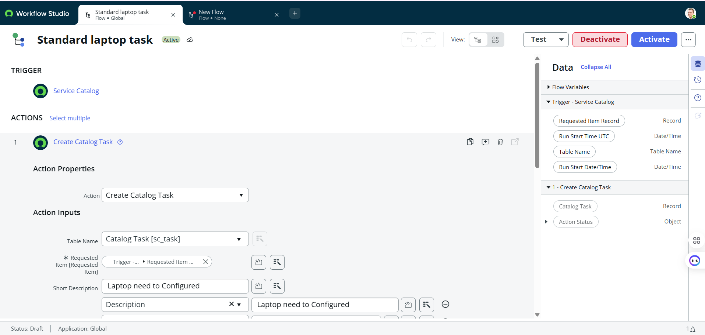
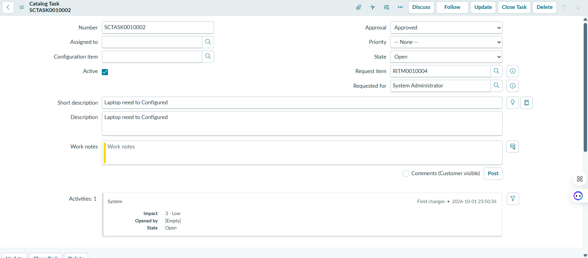
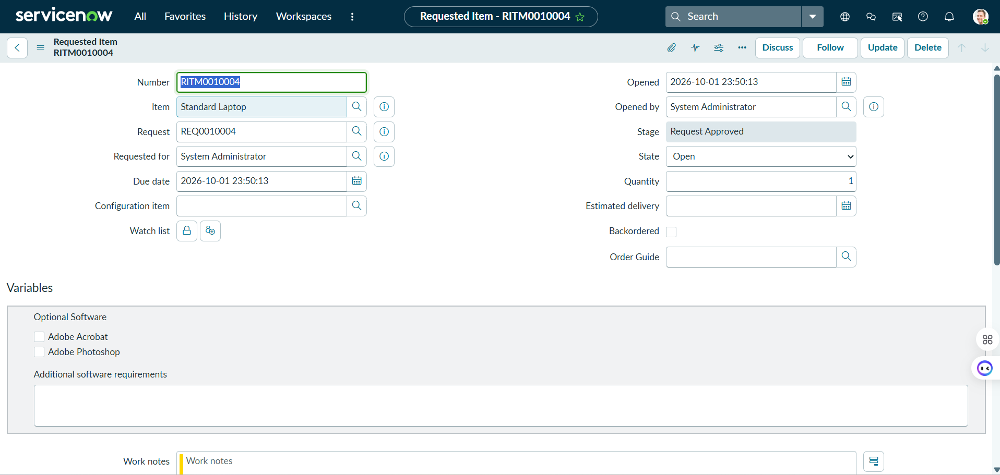
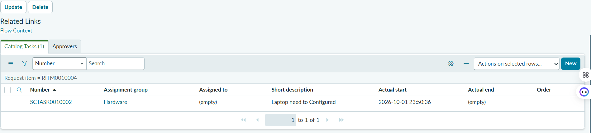

# Streamlining IT Procurement: Automating Standard Laptop Orders with Flow Designer


> Automate the creation of Catalog Tasks for Standard Laptop requests using ServiceNow Flow Designer, eliminating manual fulfillment steps and ensuring consistent assignment to the Hardware group.

---

## 📋 Table of Contents

- [Problem Statement](#-problem-statement)
- [Solution Overview](#-solution-overview)
- [Repository Structure](#-repository-structure)
- [Flow Design](#-flow-design)
- [Implementation Steps](#-implementation-steps)
- [Test Evidence](#-test-evidence)
- [Field Mapping](#-field-mapping)
- [Success Metrics](#-success-metrics)
- [Next Steps](#-next-steps)
- [Documentation](#-documentation)

---

## 🎯 Problem Statement

Manual processing of standard laptop requests creates delays, inconsistent task assignment, and poor visibility for IT fulfillment teams. Each request requires manual creation of catalog tasks, leading to errors and longer cycle times.

**Goal:** Automatically create a Catalog Task (`sc_task`) linked to the Requested Item whenever a **Standard Laptop** catalog item is ordered.

---

## ✅ Solution Overview

| Component | Value |
|-----------|-------|
| **Flow Name** | `Standard laptop task` |
| **Application** | Global |
| **Trigger** | Service Catalog (Standard Laptop) |
| **Action** | Create Catalog Task |
| **Table** | `sc_task` (Catalog Task) |
| **Assignment Group** | Hardware |
| **Short Description** | Laptop need to Configured |

**Runtime Result:**
- Request Item: `RITM0010004`
- Catalog Task: `SCTASK0010002`
- Assignment Group: Hardware
- State: Open | Active: true

---

## 📁 Repository Structure

```
servicenow-laptop-procurement-flow/
├── README.md                          # This file – project overview
├── docs/
│   ├── Project_Documentation.docx     # Full phase-wise Word document
│   ├── Project_Documentation.pdf      # Full phase-wise PDF document
│   └── Project_Documentation.pptx     # Presentation deck
├── evidence/
│   ├── 01-flow-designer-standard-laptop-task.png
│   ├── 02-catalog-task-sctask0010002.png
│   ├── 03-requested-item-ritm0010004.png
│   └── 04-ritm-related-catalog-tasks.png
└── src/
    └── flow-design-notes.md           # Detailed flow configuration notes
```

---

## 🔄 Flow Design

```
┌─────────────────────┐
│  TRIGGER            │
│  Service Catalog    │
│  (Standard Laptop)  │
└─────────┬───────────┘
          │
          ▼
┌─────────────────────┐
│  ACTION             │
│  Create Catalog Task│
│  Table: sc_task     │
│  • Requested Item   │
│  • Short Description│
│  • Description      │
└─────────┬───────────┘
          │
          ▼
┌─────────────────────┐
│  OUTPUT             │
│  SCTASK######       │
│  Group: Hardware    │
│  State: Open        │
└─────────────────────┘
```

---

## 🛠️ Implementation Steps

1. **Create Flow**  
   Workflow Studio → New Flow → Name: `Standard laptop task` → Application: Global

2. **Add Trigger**  
   Trigger type: **Service Catalog** → Select catalog item **Standard Laptop**

3. **Add Action**  
   Action: **Create Catalog Task** → Table Name: `Catalog Task [sc_task]`

4. **Map Inputs**  
   - Requested Item = `Trigger → Requested Item Record`
   - Short Description = `Laptop need to Configured`
   - Description = `Laptop need to Configured`

5. **Assignment (optional)**  
   Set Assignment Group = Hardware (or rely on existing business rules)

6. **Activate & Test**  
   Activate the flow → Submit a test request → Verify SCTASK is created under the RITM

---

## 📸 Test Evidence

### 1. Flow Designer Configuration


*Flow: Standard laptop task (Active) | Trigger: Service Catalog | Action: Create Catalog Task*

### 2. Catalog Task Created


*SCTASK0010002 | Short description: Laptop need to Configured | State: Open | Request item: RITM0010004*

### 3. Requested Item


*RITM0010004 | Item: Standard Laptop | Stage: Request Approved | State: Open*

### 4. Related Catalog Tasks on RITM


*Catalog Tasks (1) | SCTASK0010002 | Assignment group: Hardware | Actual start populated*

---

## 📊 Field Mapping

| Field | Source / Value | Target |
|-------|----------------|--------|
| Requested Item | Trigger → Requested Item Record | `sc_task.request_item` |
| Short Description | Static: `Laptop need to Configured` | `sc_task.short_description` |
| Description | Static: `Laptop need to Configured` | `sc_task.description` |
| Assignment Group | Hardware | `sc_task.assignment_group` |
| State | Open (default) | `sc_task.state` |
| Active | true | `sc_task.active` |

---

## 📈 Success Metrics

| Metric | Target / Observed |
|--------|-------------------|
| Automated task creation rate | 100% of Standard Laptop RITMs |
| Average flow execution time | < 5 seconds after RITM creation |
| Manual steps removed | Catalog Task creation fully automated |
| Assignment consistency | Hardware group applied consistently |

---

## 🚀 Next Steps

1. Extend the same pattern to other standard hardware catalog items (monitors, docking stations, etc.)
2. Add approval logic or dynamic assignment based on location / cost center
3. Surface catalog variables (optional software) into the Catalog Task description
4. Create a dashboard for the Hardware group showing open SCTASKs from this flow
5. Publish a Knowledge Base article and link it from the catalog item

---

## 📚 Documentation

Full phase-wise project documentation is available in the `docs/` folder:

| File | Description |
|------|-------------|
| [Project_Documentation.docx](docs/Project_Documentation.docx) | Complete Word document |
| [Project_Documentation.pdf](docs/Project_Documentation.pdf) | PDF version |
| [Project_Documentation.pptx](docs/Project_Documentation.pptx) | Presentation deck |

Phases covered:
1. Ideation
2. Requirement Analysis
3. Project Design
4. Project Planning
5. Development
6. Documentation & Handover

---

## 📄 License

Internal project documentation. For use within authorized ServiceNow implementations only.

---

**Built with ServiceNow Flow Designer | Service Catalog | IT Service Management**
